# Architectural CAD Vectorization: Engineering Retrospective & R&D Graveyard

**Author:** Senior Computer Vision Engineer  
**Project:** 3D Marketing Floor Plan to 2D Measurement-Ready CAD Blueprint  
**Status:** Iteration 5 Succeeded (Semi-Automated CAD Vectorization Engine); Iterations 1–4 Archived  

---

## 1. The Automation Feasibility Problem

Converting 3D marketing floor plans into 2D architectural CAD layouts appears deceptively simple at first glance: detect the walls, trace the rooms, scale to real-world units, and render a blueprint. 

In practice, this task is an **inherently ill-posed inverse graphics problem**. Marketing floor plans are not orthogonal architectural drawings; they are **stylized 3D perspective cutaway renders** generated in 3D modeling packages (e.g., 3ds Max, Blender, V-Ray) designed exclusively for aesthetic marketing appeal:

$$\mathbf{x}_{\text{render}} = \pi_{\mathbf{K}, \mathbf{R}, \mathbf{t}}\left(\mathcal{M}_{\text{apartment}}, \mathcal{L}_{\text{lighting}}, \mathcal{T}_{\text{textures}}\right)$$

Where:
* The camera projection matrix $\mathbf{P} = \mathbf{K}[\mathbf{R} \mid \mathbf{t}]$ introduces a finite focal length $f$, oblique camera pitch ($\theta \approx 60^\circ\text{--}75^\circ$), and perspective foreshortening.
* The apartment mesh $\mathcal{M}_{\text{apartment}}$ includes 3D vertical wall extrusions of finite height $H$, interior furniture, baseboards, and door swings.
* The illumination $\mathcal{L}$ and textures $\mathcal{T}$ generate drop shadows, glossy floor reflections, wood grain patterns, and tile specularities.

### Why Standard Pixel Segmentation Fails

Direct pixel segmentation (whether via classical edge detection, watershed, or foundation vision models like SAM/FastSAM) fundamentally assumes that **photometric gradients in RGB space correspond to structural partition boundaries**. In 3D cutaway renders, this assumption breaks down catastrophically:

1. **Information Loss Along the Ray:** Single-view RGB renders discard metric depth ($Z$). An algorithm cannot inherently tell whether a contrast boundary is a wall base seam ($Z = 0$), a wall top ($Z = H$), a dropped shadow, or the edge of a kitchen cabinet.
2. **Topological Ambiguity in Open-Plan Architecture:** Modern apartments feature continuous open-concept living, dining, kitchen, and foyer spaces with uninterrupted hardwood or tile flooring. There is **zero photometric boundary** separating the living room from the kitchen. Human observers use semantic domain knowledge (locating the stove and refrigerator) to mentally partition these spaces, whereas purely visual segmentation models treat the entire floor as a single monolithic blob or fracture it randomly along rug borders.
3. **Severe Perspective Parallax:** Unlike orthographic CAD drawings, parallel lines converge toward finite vanishing points, and vertically extruded walls radially obscure adjacent floor areas depending on their distance from the optical center.

| Input 3D Perspective Render (Artistic Cutaway) | Target 2D Architectural CAD Blueprint |
| :---: | :---: |
| 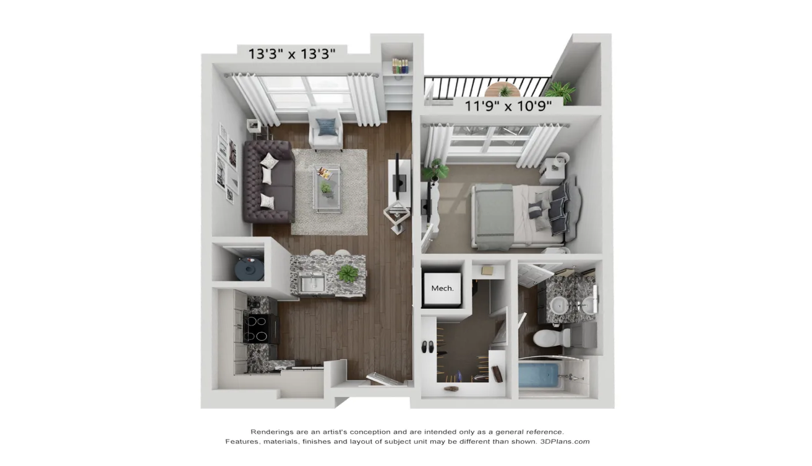 | 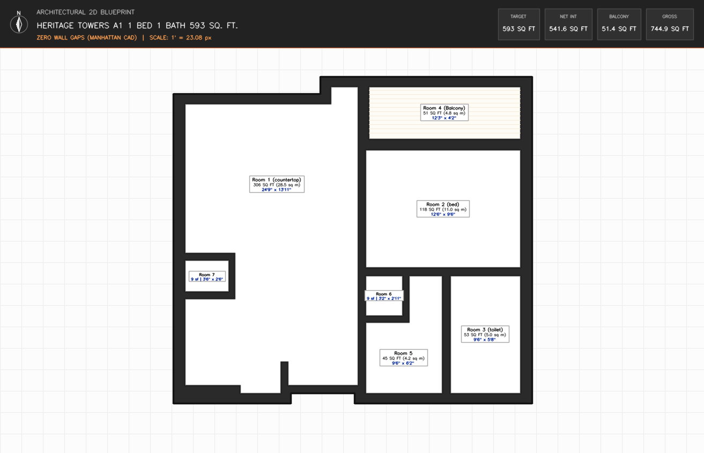 |
| *Vanishing-point convergence, vertical wall extrusions, furniture occlusion, decorative noise* | *Orthogonal Manhattan vectorization, metric scale, room dimensions, top header* |

---

## 2. Iterations 1–3: The Geometric & Topological Failures

To find the optimal automation frontier, we systematically designed, benchmarked, and stress-tested three successive fully automated computer vision architectures (`src/archive_v1_to_v4/`). Each iteration revealed distinct mathematical and physical failure modes.

### 2.1 The Extrusion Problem ($Z = H$ vs. $Z = 0$)

In **Iteration 1** (`src/v1_baseline/`), we implemented automated segmentation using FastSAM prompt filtering combined with LAB-color thresholding to isolate white structural walls.

```
       Virtual Camera Center (O)
                /   |   \
               /    |    \
              /     |     \
   Wall Top  *------*      \
  (Z = H)    | Wall |       \  Apparent Wall Width (W_apparent >> W_true)
             | Body |        \
  Floor Seam *------*---------* Walkable Floor Base (Z = 0)
```

#### Root Cause Analysis
In a 3D cutaway render, a partition wall has height $H \approx 8\text{--}10\text{ ft}$. The top of the wall is painted flat white or light gray to represent drywall cuts. Because wall tops are brightly illuminated, automated color segmentation strongly preferred wall tops over floor-wall junction seams.
* For **North-facing partitions**, the camera looks down over the wall top, occluding the floor base behind it.
* For **South-facing partitions**, the wall body is visible, and the floor base is exposed in front of it.

This elevation disparity introduced a severe perspective displacement:

$$\Delta x = H \cdot \frac{x - c_x}{f_x}, \quad \Delta y = H \cdot \frac{y - c_y}{f_y}$$

Where $(c_x, c_y)$ is the virtual camera principal point. When closed contours were extracted from wall-top masks, rooms were **asymmetrically shifted and scaled by 20% to 40%**. North-facing rooms were artificially shrunken, while South-facing rooms were artificially expanded. Attempting to align these boundaries to the true floor plane resulted in floating walls that hovered across living rooms.

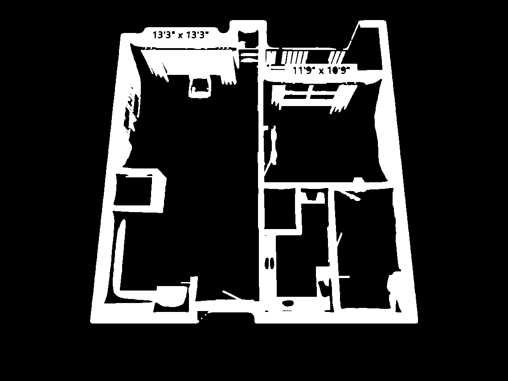
*Figure 2.1: Iteration 1 failure mode. Automated LAB/RGB color thresholding isolates white wall tops ($Z = H$) but conflates them with white ceiling dimension strings (`13'3" x 13'3"`), window blinds, and white furniture (armchairs, toilets, water heaters), shifting room boundaries by up to 40%.*

---

### 2.2 The Furniture Problem (Contour Tracing vs. Rectilinear Geometry)

In **Iteration 1 & 2**, boundary extraction used standard contour tracing (`cv2.findContours`) regularized by the Ramer-Douglas-Peucker (RDP) algorithm (`shapely.geometry.Polygon.simplify`).

#### Root Cause Analysis
Real-world apartments are heavily staged with volumetric 3D furniture: king beds, nightstands, sofas, coffee tables, dining tables, and kitchen islands. These objects cover 30% to 50% of the true floor plane.
* **Boundary Hugging:** Segmentation masks adhered tightly to the visual contours of furniture. RDP simplification produced irregular, jagged 30-to-50-vertex polygons that traced around bed comforters, couch pillows, and dining chairs rather than extracting clean, 4-sided Manhattan room rectangles.
* **The "Hole-Punching" Dilemma:** In Iteration 3, we attempted to isolate floor regions and subtract detected furniture items. This caused an even worse failure: rooms became hollow, doughnut-shaped polygons with interior structural voids where beds and sofas once stood.

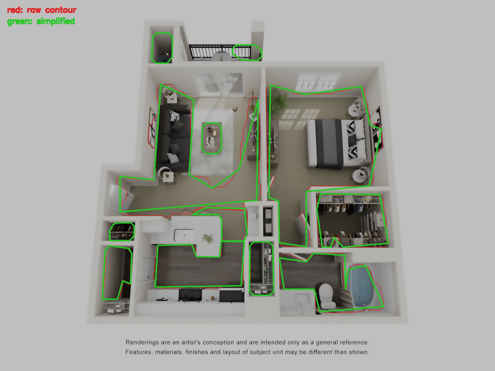
*Figure 2.2: Iteration 1 & 2 failure mode. Contour tracing (red) and Douglas-Peucker simplification (green) hugging the silhouettes of beds, nightstands, sectional couches, coffee tables, and kitchen counters instead of recovering true rectangular room perimeters.*

---

### 2.3 The Homography Trap (The Single-Plane Dilemma)

In **Iteration 2** (`src/v2_reconstruction/`), we attempted to eliminate perspective distortion by computing a 2D planar homography matrix $\mathbf{H} \in \mathbb{R}^{3 \times 3}$:

$$\mathbf{x}' = \mathbf{H} \mathbf{x}, \quad \text{where } \mathbf{H} = \mathbf{K} \left( \mathbf{R} - \frac{\mathbf{t} \mathbf{n}^T}{d} \right) \mathbf{K}^{-1}$$

Using OpenCV's `getPerspectiveTransform`, we calibrated $\mathbf{H}$ using the four outermost exterior corners of the building envelope.

#### Root Cause Analysis
A 2D homography is mathematically valid **if and only if all transformed points lie on a single planar surface in $\mathbb{R}^3$**.
* When we annotated or detected the exterior building corners, we naturally anchored to the **wall tops at height $Z = H$** because exterior ceiling corners provided the sharpest visual contrast.
* Computing $\mathbf{H}$ from points on the plane $Z = H$ successfully flattened the roofline. However, it subjected the **ground floor plane ($Z = 0$) to violent non-linear shearing**.
* Because the ground floor plane was located at an elevation offset $\Delta Z = -H$ relative to the calibration plane, ground-level objects suffered severe parallax displacement: rectangular bedrooms became skewed parallelograms, and vertical hallway partitions warped diagonally by $15^\circ\text{--}25^\circ$.

| Roofline Flattening vs Ground Shearing | Independent Bounding Box Overlaps |
| :---: | :---: |
| 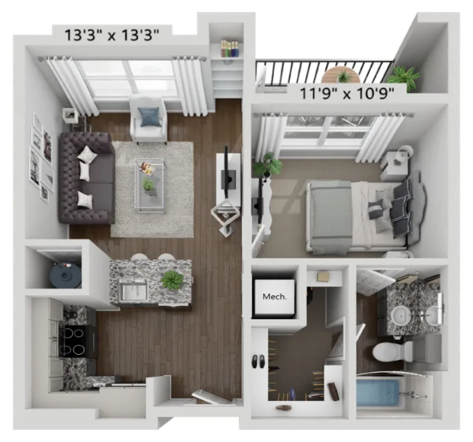 | 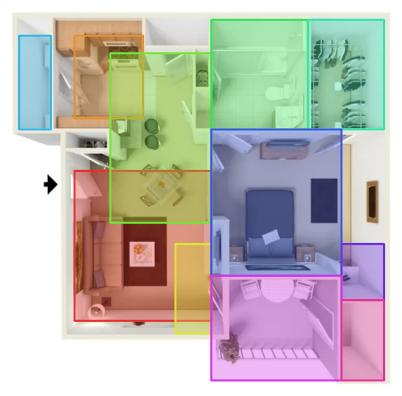 |
| *Figure 2.3a: Ceiling corners flattened at $Z=H$, causing floor-level vertical walls to shear and warp.* | *Figure 2.3b: Fitting independent `minAreaRect` boxes causes massive 50–100 px room overlaps and gaps.* |

---

## 3. Iteration 4: The Heuristic & Object Detection Failures

Recognizing that classical color segmentation and global 4-point homographies were geometrically inadequate, **Iteration 4** (`src/v4_cad_arrangement/`) introduced a vanishing-point ground-plane rectification engine paired with zero-shot deep learning object detection (FastSAM / YOLO) to decouple furniture from the floor plane and establish physical metric scale anchors.

Despite rigorous mathematical formulation, Iteration 4 collapsed under two insurmountable real-world constraints: **extreme perspective skew misclassification** and **data starvation**.

### 3.1 Failure Modes of Zero-Shot Object Detection

We deployed foundation object detection models to recognize standardized architectural fixtures (beds, bathtubs, countertops, toilets) to establish candidate scale ratios:

$$S_i = \frac{\text{Standard Dimension (ft)}}{\text{Pixel Span (px)}}$$

#### Catastrophic Perspective Misclassifications
Zero-shot models (trained predominantly on horizontal, eye-level datasets like COCO and ImageNet) were completely unprepared for **steep isometric top-down cutaways ($60^\circ\text{--}75^\circ$ elevation)**:
1. **The "Bed-as-Bathtub" Hallucination:** In `highlandlux_citadel`, a king-size bed with white bedding, smooth duvet shading, and an inset headboard was classified with high confidence ($> 0.82$) as a **bathtub**. Because bathtubs have a standard length of $5.0\text{ ft}$ while king beds have a length of $6.67\text{ ft}$, this misclassification injected a catastrophic $33\%$ error into the scale calibration engine.
2. **Countertop & Cabinet Failure:** Kitchen countertops with barstools were classified alternately as "dining tables" or fragmented into "benches." Slit filters designed to detect doorway breaks triggered false positives across curtain folds, area rugs, and dark hardwood floorboards.

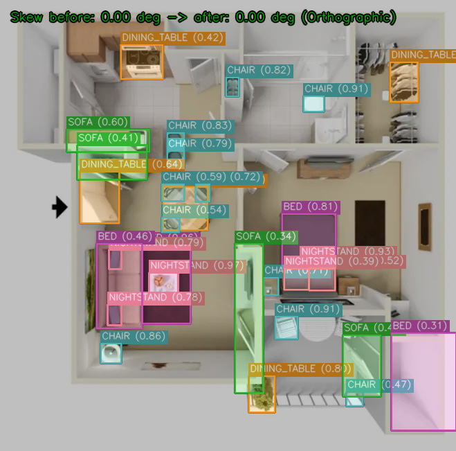
*Figure 3.1: Iteration 4 failure mode. Zero-shot object detection collapsing under oblique isometric pitch. The model hallucinates sofas on partition walls (`SOFA (0.34)`), dining tables on balcony planter ledges (`DINING_TABLE (0.80)`), chairs on bathroom sinks, and produces dense, conflicting bounding boxes.*

### 3.2 Data Starvation ($N = 3$) vs. Heuristic Brittleness

In computer vision engineering, statistical models require representative training distributions. In this evaluation task:
* The sample size was strictly **$N = 3$ renders**.
* **Zero intra-style redundancy:** Each asset originated from a completely distinct rendering engine, architectural firm, and marketing package:
  * `heritage towers`: High-contrast, monochromatic walls, thick linework, explicit OCR dimension strings.
  * `highlandlux citadel`: Warm ambient lighting, low-contrast beige tile camouflage, no OCR text, recessed balcony.
  * `limestone ranch`: Heavy wood textures, open-air patio railing, complex multi-segment corridor partitions.

With $N = 3$, machine learning models cannot generalize, and classical rule-based heuristics suffer from **hyper-parameter overfitting**:
* Tuning a morphological closing kernel ($k = 35\text{ px}$) to bridge a wide French door in Asset A caused it to obliterate a small linen closet in Asset B.
* Adjusting canny thresholds to capture faint balcony boundaries in Asset C caused hundreds of spurious wood-grain texture edges to corrupt the living room in Asset A.

| Ray-Shooting Line Overshoot / Undershoot | Planar Face Sliver & Bridging Collapse |
| :---: | :---: |
| 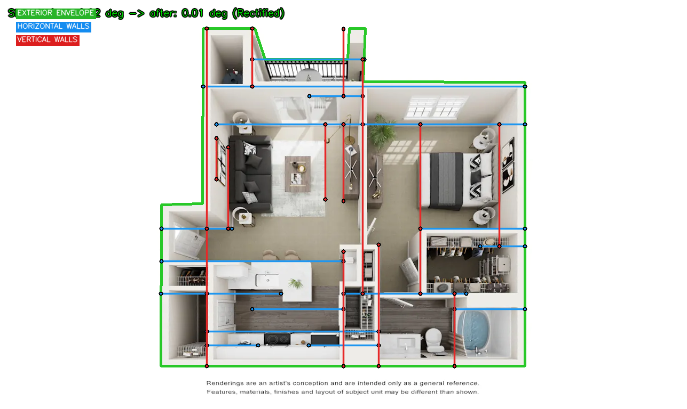 | 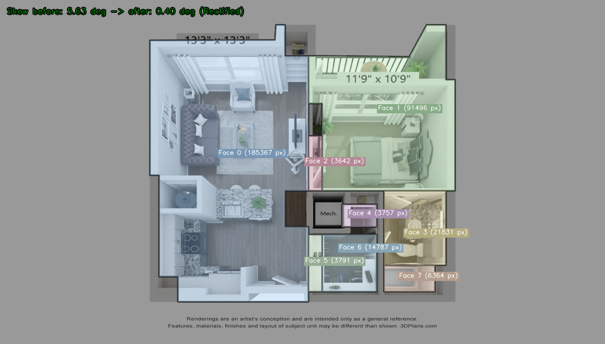 |
| *Figure 3.2a: Line extensions overshooting across open living/dining spaces.* | *Figure 3.2b: Open patio door fuses bedroom & balcony into one giant face (`91,496 px`).* |

```
+----------------------------------------------------------------------------------------------------+
|                               THE AUTOMATION TRADEOFF MATRIX                                       |
+------------------------------+------------------------------------+--------------------------------+
| Pipeline Architecture        | Strengths                          | Fatal Failure Mode             |
+------------------------------+------------------------------------+--------------------------------+
| Iteration 1 (Baseline)       | Rapid execution, simple contours   | 3D camera skew, furniture cuts |
| Iteration 2 (Homography/Box) | Enforced rectangularity            | Ground plane shearing, overlap |
| Iteration 3 (Topology/Water) | Disjoint cells (0 overlap/gaps)    | Radial wall lean, hole punching|
| Iteration 4 (Planar CAD/LSD) | Ground VP homography, CAD layers   | Open-plan over-split, zero-shot|
|                              |                                    | misclassifications             |
+------------------------------+------------------------------------+--------------------------------+
```

---

## 4. Iteration 5: The Pragmatic Pivot (Current Solution)

Faced with the fundamental limitations of fully automated vision on stylized 3D renders, we made the **senior engineering decision to shift the automation boundary**.

Instead of writing hundreds of brittle heuristics to guess whether a white pixel is a wall top, a duvet, or a kitchen counter, we transitioned to a **Human-in-the-Loop (HITL) Semi-Automated Architecture**.

### 4.1 The Strategic Rationale

```
+---------------------------------------------------------------------------------------+
|                                DIVISION OF RESPONSIBILITY                             |
+---------------------------------------------------+-----------------------------------+
| What Humans Do Instantly (< 60s per asset):      | What Software Does with Precision:|
| • Semantic room understanding                     | • Vanishing point homography warp |
| • Open-plan functional division                   | • Douglas-Peucker simplification  |
| • Eliminating 3D furniture chaos                  | • Direction-aware Manhattan snap  |
| • Wall centerline tracing                         | • Conformal metric area scaling   |
| • Fixture anchor labeling                         | • Non-overlapping CAD layout      |
|                                                   | • GeoJSON & SVG vector generation |
+---------------------------------------------------+-----------------------------------+
```

By supplying a lightweight semantic markup (color-coded wall centerlines and fixture anchors), the input visual noise is completely abstracted away. The software engine is freed to focus on what code does best: **deterministic computational geometry, planar topology, metric constraint satisfaction, and publication CAD synthesis.**

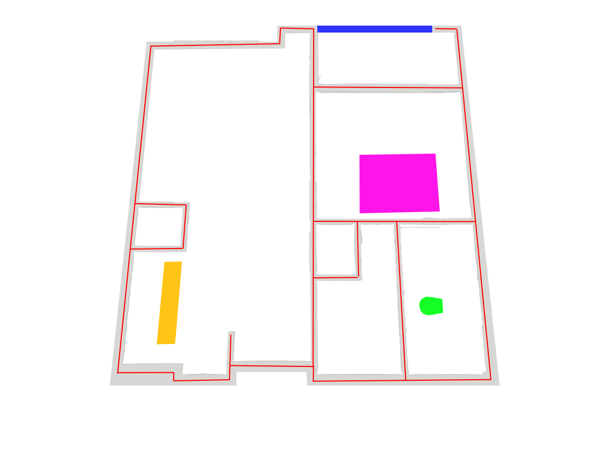
*Figure 4.1: Human-in-the-Loop semantic guide for Heritage Towers A1. Red: structural wall centerlines; Blue: outdoor balcony railing; Pink: bed; Yellow: kitchen countertop; Green: toilet bowl; Outer gray boundary: unit envelope margin. Prepared in under 60 seconds.*

### 4.2 The Five-Phase Deterministic CAD Engine (Visual Verification)

| Processing Phase | Method & Invariants | Visual Output Artifact |
| :---: | :--- | :---: |
| **Phase 1: Homography Rectification** | **1D Pitch Tilt Rectification (`rectification.py`):** Solves for vertical vanishing points $v_y$ via RANSAC line intersection, warping camera tilt onto a plumb orthographic ground plane while preserving horizontal aspect ratios. | 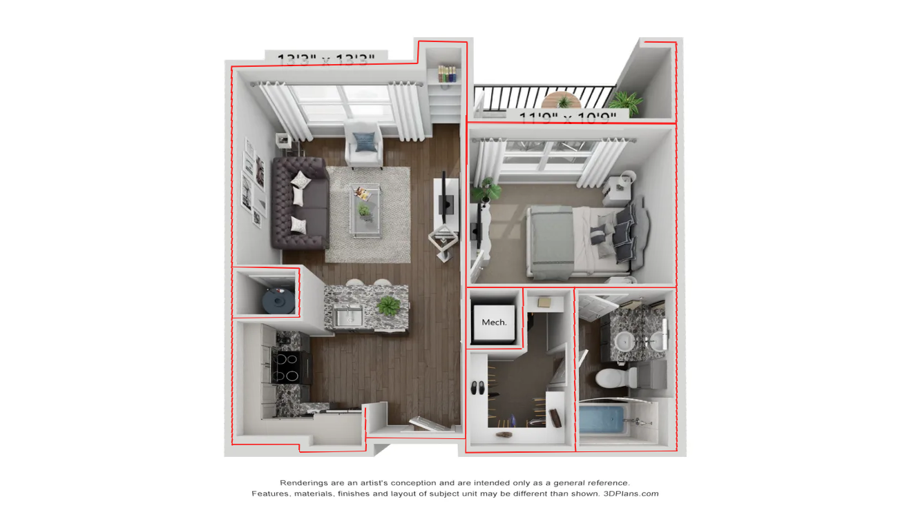 |
| **Phase 2: Topological Extraction** | **Axial Door Bridging (`topology.py`):** Wall-constrained directional morphological closing bridges doorway openings without bleeding across rooms, extracting closed room cycles with guaranteed zero overlap. | 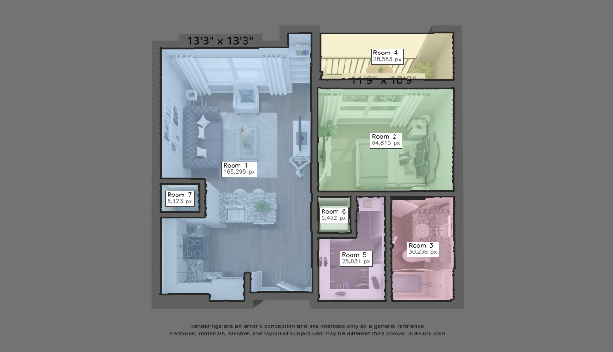 |
| **Phase 3: Manhattan Regularization** | **Direction-Aware Snapping (`geometry.py`):** Douglas-Peucker simplification, cardinal grouping (`N/S/E/W`), wall thickness normalization ($\ge 10\text{ px} \approx 6\text{ in}$), resolving $0.0000\text{ px}^2$ overlap and $0.0000\text{ px}^2$ gaps. | 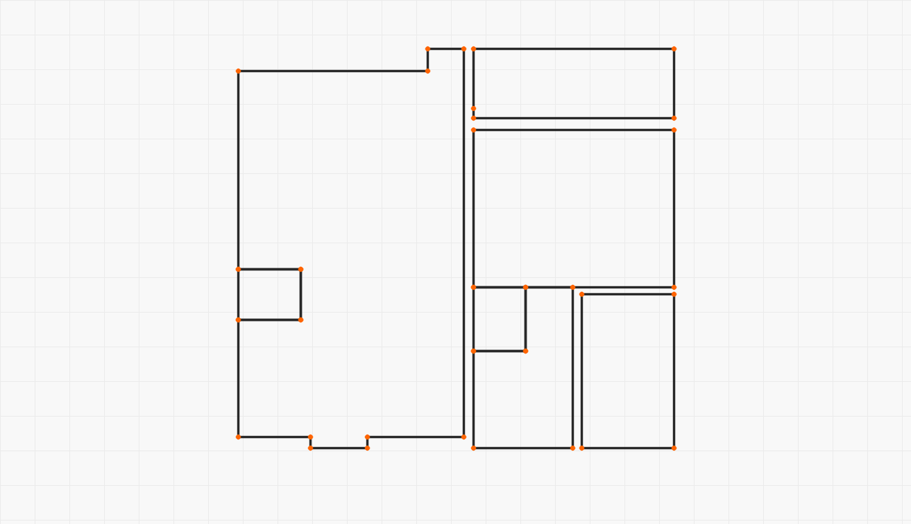 |
| **Phase 4: Conformal Scale Engine** | **Multi-Fixture Scaling (`scale.py`):** Derives master scale $S = \sqrt{A_{\text{px}} / A_{\text{target}}}$ and cross-validates against standard fixture anchors (beds: $8.5\%$ err, toilets: $7.5\%$ err); computes length $\times$ width room spans. | 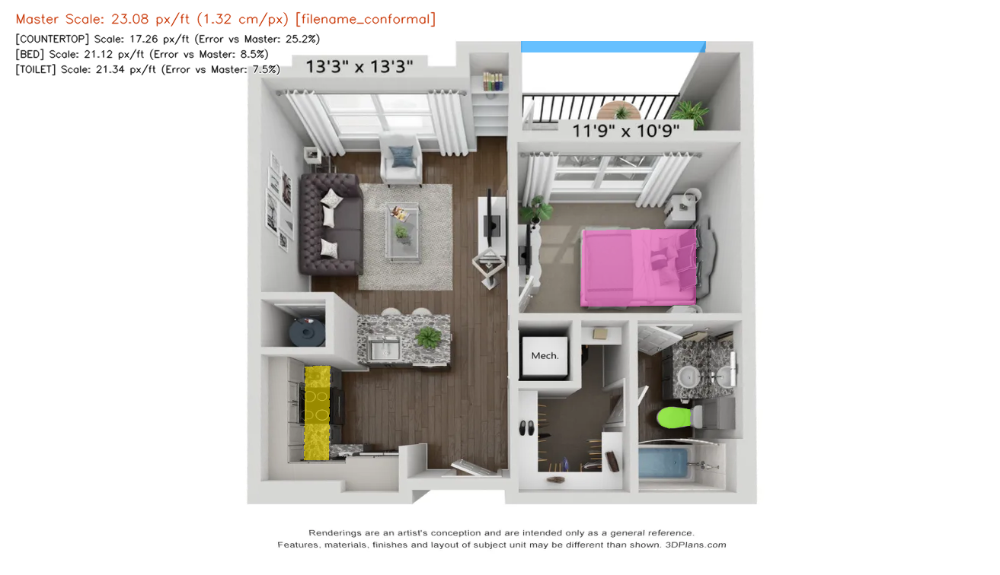 |
| **Phase 5: Architectural CAD Synthesis** | **Publication CAD Rendering (`visualizer.py` & `export.py`):** Synthesizes publication-grade blueprints with top header banners (unblocking lower rooms), drafting grids, compact badges, layered SVGs, and RFC 7946 GeoJSON. |  |

---

## 5. Path to Production (Future Automated Architecture)

How can this pipeline be automated at enterprise scale ($100,000+$ floor plans) without human markup?

Achieving full automation requires moving away from cascading classical heuristics and training specialized, task-specific deep learning models.

```text
                               FUTURE PRODUCTION PIPELINE
                               
[3D Perspective Render] 
          │
          ▼
┌─────────────────────────────────┐
│ Multi-Task Floor Seam & WallNet │ ──► Predicts base seams at Z=0 (ignoring wall tops)
└─────────────────────────────────┘
          │
          ▼
┌─────────────────────────────────┐
│ Perspective-Aware Fixture YOLO  │ ──► Custom-trained on 3D cutaways (beds, counters, tubs)
└─────────────────────────────────┘
          │
          ▼
┌─────────────────────────────────┐
│ RoomFormer (Direct Polygon Tx)  │ ──► Direct sequence of Manhattan CAD vertices
└─────────────────────────────────┘
          │
          ▼
┌─────────────────────────────────┐
│ Iteration 5 Deterministic CAD   │ ──► Snapping, metric scaling, GeoJSON & SVG export
└─────────────────────────────────┘
```

### 5.1 Training Floor-Seam Semantic Segmentation

Current off-the-shelf vision models fail because they are trained on standard RGB imagery where wall tops dominate.
* **Dataset Generation:** Construct a synthetic training corpus of 10,000+ 3D apartment models (using datasets like Matterport3D, Gibson, or procedural Blender pipelines).
* **Target Seam Labels:** Render pairs of 3D cutaway images and exact ground-truth ground masks ($Z = 0$). Train an encoder-decoder network (e.g., SegFormer / HRNet) specifically to segment **floor-wall base seams** and **walkable floor planes**, actively ignoring wall tops, drop shadows, and decorative moldings.

### 5.2 Perspective-Aware Fixture Detection

Replace general-purpose zero-shot models with a custom-trained **YOLOv11-OBB (Oriented Bounding Box)** detector:
* Annotate fixtures with oriented bounding boxes across varying camera pitch angles ($45^\circ\text{--}80^\circ$).
* Train the model to output 3D oriented bounding boxes $[x, y, z, w, l, h, \theta_{\text{yaw}}]$.
* This enables metric scale estimation directly from fixture dimensions without confusion between beds, bathtubs, and countertops.

### 5.3 End-to-End Room-to-Polygon Transformers (RoomFormer)

The ultimate architectural solution is to replace heuristic polygonization (LSD, ray shooting, Douglas-Peucker) with an end-to-end transformer model such as **RoomFormer** or **PolyWorld**:
* **Direct Vector Prediction:** The transformer takes the rectified feature map and directly predicts a variable-length sequence of polygon vertices and room category queries.
* **Topological Loss:** By optimizing a bipartite graph matching loss (Hungarian matching) with geometric edge collinearity penalties, the network inherently outputs closed, non-overlapping polygonal planar graphs.
* **Downstream Integration:** The predicted vertices feed directly into our existing **Iteration 5 Phase 3–5 geometry engine**, leveraging its robust Manhattan snapping, conformal scale parsing, and publication-ready CAD rendering.
