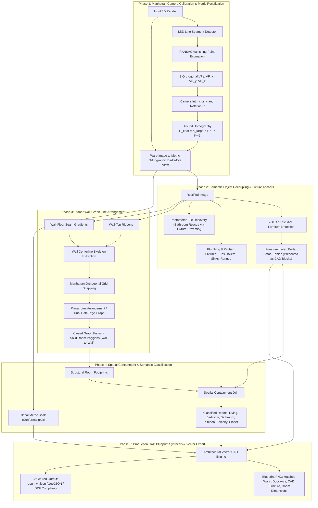

# Iteration 4 — Metric Vanishing-Point Rectification, Planar Wall Arrangement, and Semantic CAD Reconstruction

## 1. Executive Summary & R&D Evolution

Iteration 1, 2, and 3 revealed the fundamental limitations of treating 3D cutaway architectural renders with 2D computer vision heuristics:
- **Iteration 1 (`src/v1_baseline/`)** attempted direct 2D contour tracing on raw 3D perspective renders. It preserved perspective skew, hugged furniture outlines, and confused EasyOCR font sizes with architectural floor scale.
- **Iteration 2 (`src/v2_reconstruction/`)** attempted 4-point homography warping on exterior wall tops, followed by independent bounding-box fitting. Warping wall tops ($Z = H$) sheared the floor plane ($Z = 0$), causing independent boxes to produce massive 50–100 px overlaps and misinterpreting curtain and furniture gaps as doors.
- **Iteration 3 (`src/v3_topology/`)** dropped homography to prevent shearing, introduced a marker-based watershed cell complex on the original render, orthogonalized shared walls with a Manhattan line graph, and scaled from the filename unit area. While this guaranteed 0 overlap and 0 gaps inside the footprint, it suffered from three critical flaws:
  1. **Perspective Radial Wall Lean:** Opposing partition walls leaned away from each other by 15–30 px, leaving "double-wall chasms" where parallel edges were too far apart to snap safely.
  2. **Furniture Subtraction ("Rooms with Holes"):** Opaque furniture (the king bed in Limestone Ranch, the sofa in Living Room) survived as floor masks and was punched out of parent rooms, creating U-shaped living rooms and bedrooms with structural voids.
  3. **White-Tile Photometric Camouflage:** Highland Lux's bathroom tile shared high lightness and low chroma with wall tops, causing FastSAM to discard the bathroom floor entirely.

**Iteration 4 (`src/v4_cad_arrangement/`)** solves these root causes by replacing bottom-up pixel clustering with a **principled 3D camera calibration, metric ground rectification, planar wall-graph arrangement, and semantic CAD synthesis pipeline**.

---

## 2. In-Depth Asset & Geometric Analysis

Across the three reference input assets in `inout_data/`:

| Asset | Image Dimensions | Camera Angle & Optics | Flooring Variance | Structural Obstacles |
| :--- | :--- | :--- | :--- | :--- |
| **`heritage towers`** | 1140 × 855 | Oblique central perspective ($\sim 65^\circ$ elevation). Vertical walls lean radially away from principal point. | Dark wood planks (living/kitchen) vs. beige carpet (bed/closet) vs. blue-grey tile (bath). | North-facing walls show wall-floor base seam; south-facing wall tops occlude base seam. 25 px corridor chasm. |
| **`highlandlux-citadel`** | 659 × 651 | Near-overhead perspective with subtle center convergence. | White square tile (kitchen/bath) vs. tan carpet (bed/living) vs. grey balcony decking. | White bathroom tile is photometrically identical to flat wall tops in LAB space ($L \ge 250, \text{chroma} \le 8$). |
| **`limestone ranch`** | 1140 × 855 | Oblique perspective with strong top-down directional lighting and heavy furniture cast shadows. | Dark wood planks (kitchen/bath) vs. beige carpet (bed/living). | Large king bed and sectional sofa occupy 30% of bedroom/living floors. Bifold utility closet doors open at $45^\circ$. |

---

## 3. Iteration 4 Architectural Blueprint



---

## 4. Phase-by-Phase Implementation Specifications

### Phase 1: Metric Camera Calibration & Ground Rectification (`calibration.py`)

**Objective:** Correct perspective wall lean by computing the true metric ground-plane homography $H_{\text{floor}}$ from the image's three orthogonal vanishing points.

**Mathematical Formulation:**
1. A Manhattan world contains three mutually orthogonal directions: $d_1 = (1, 0, 0)^T$, $d_2 = (0, 1, 0)^T$, $d_3 = (0, 0, 1)^T$.
2. Under camera projection $P = K [R \mid t]$, direction $d_i$ projects to vanishing point $v_i \sim K R d_i = K r_i$, where $r_i$ is column $i$ of rotation matrix $R$.
3. With zero skew and square pixels, camera intrinsics $K$ is parameterized by focal length $f$ and principal point $(c_x, c_y) = (W/2, H/2)$:
   $$K = \begin{bmatrix} f & 0 & c_x \\ 0 & f & c_y \\ 0 & 0 & 1 \end{bmatrix}$$
4. Orthogonality condition between horizontal vanishing points $v_1 = (x_1, y_1, 1)^T$ and $v_2 = (x_2, y_2, 1)^T$:
   $$v_1^T K^{-T} K^{-1} v_2 = 0 \iff (x_1 - c_x)(x_2 - c_x) + (y_1 - c_y)(y_2 - c_y) + f^2 = 0$$
   $$f = \sqrt{- \left( (x_1 - c_x)(x_2 - c_x) + (y_1 - c_y)(y_2 - c_y) \right)}$$
5. The rotation columns are $r_1 = \frac{K^{-1} v_1}{\|K^{-1} v_1\|}$, $r_2 = \frac{K^{-1} v_2}{\|K^{-1} v_2\|}$, and vertical axis $r_3 = r_1 \times r_2$.
6. The ground rectification homography mapping the perspective floor plane ($Z = 0$) to an orthographic top-down coordinate system is:
   $$H_{\text{floor}} = K_{\text{target}} \cdot R^T \cdot K^{-1}$$
   where $K_{\text{target}}$ scales and centers the bounding bounding box of the apartment.

**Deliverables:**
- `src/v4_cad_arrangement/calibration.py`: `ManhattanCalibrator.calibrate_and_rectify(image) -> RectificationResult`
- `scripts/v4_test_calibration.py`: Writes `01_lsd_lines.png`, `02_vanishing_points.png`, `03_rectified_floor.png`.

---

### Phase 2: Semantic Object Decoupling & Fixture Anchors (`semantics.py`)

**Objective:** Separate furniture from structural floors so rooms remain solid polygons, and detect fixtures to rescue camouflaged rooms.

**Key Requirements:**
1. **Furniture Decoupling:** Detect beds, sofas, tables, and rugs via FastSAM/YOLO. Mark their bounding polygons as `CADObject(category, polygon, bbox)`.
2. **Floor Integrity Rule:** Furniture masks must **never** be subtracted from floor masks. The floor extends continuously underneath furniture.
3. **Bathroom Rescue via Fixtures:** Detect plumbing fixtures (toilets, tubs, sinks) using geometric and color template priors (e.g. oval toilet bowl, blue-water tub rectangle).
4. Any connected interior region containing a toilet or bathtub is seeded as **Bathroom**, even if its floor tile is pure white ($L \ge 250$).

**Deliverables:**
- `src/v4_cad_arrangement/objects.py`: `ObjectDetector.detect(rectified_image) -> ObjectDetectionResult`
- `scripts/v4_test_objects.py`: Writes `04_detected_furniture.png`, `05_fixture_anchors.png`.

---

### Phase 3: Planar Wall-Graph Line Arrangement (`arrangement.py`)

**Objective:** Extract wall centerlines and compute their planar line arrangement to generate room polygons with zero gaps and zero overlaps.

**Key Requirements:**
1. In the rectified image from Phase 1, all interior and exterior walls are strictly horizontal ($0^\circ$) or vertical ($90^\circ$).
2. **Exterior Envelope:** Trace the outermost perimeter of the apartment silhouette as an orthogonal polygon.
3. **Interior Wall Centerlines:**
   - Detect wall ribbons (tops and base seams).
   - Apply morphological thinning/skeletonization to extract 1-pixel wide centerline segments.
   - Snap collinear and parallel segments within $15\text{ px}$ to a shared Manhattan coordinate.
4. **Planar Line Arrangement:**
   - Extend wall centerlines to intersect adjacent walls and the exterior envelope.
   - Use `shapely.ops.polygonize` on the snapped line network to extract the minimal closed polygonal faces (cycles of the planar graph).
   - Each closed face is a distinct, solid room polygon that shares exact 1D line boundaries with its neighbors.

**Deliverables:**
- `src/v4_cad_arrangement/arrangement.py`: `PlanarWallArranger.arrange(rectified_image, envelope) -> list[Polygon]`
- `scripts/v4_test_arrangement.py`: Writes `06_wall_centerlines.png`, `07_planar_faces.png`.

---

### Phase 4: Spatial Containment & Semantic Classification (`classification.py`)

**Objective:** Associate furniture and fixtures with room polygons and assign architectural room categories.

**Classification Rules:**
- **Bedroom:** Polygon contains a detected Bed object or closet shelving cluster.
- **Bathroom:** Polygon contains a Toilet or Bathtub fixture.
- **Kitchen:** Polygon contains a Stove/Range, Kitchen Sink, or Refrigerator.
- **Living / Dining Room:** Polygon contains a Sofa, TV Stand, or Dining Table.
- **Balcony:** Polygon located outside the primary exterior envelope with railing perimeter.
- **Walk-in Closet / Storage:** Small enclosed polygon ($< 45\text{ sq ft}$) adjacent to Bedroom or Hallway.

**Scale Engine:**
- Parse unit size from filename (e.g. `593 Sq. Ft.`, `623 Sq. Ft.`, `625sq`).
- $S = \sqrt{\frac{\sum \text{Area}(\text{Room Polygons})}{\text{Total Sq Ft}}}$ (conformal pixels per foot across the rectified plane).
- Room nominal dimensions: compute minimum bounding box width and length in feet: $W = \text{span}_x / S$, $L = \text{span}_y / S$.

**Deliverables:**
- `src/v4_cad_arrangement/classification.py`: `RoomClassifier.classify(rooms, objects, scale) -> list[ArchitecturalRoom]`
- `scripts/v4_test_classification.py`: Writes `08_semantic_rooms.png`.

---

### Phase 5: Production CAD Blueprint Synthesis (`visualizer.py` and `main.py`)

**Objective:** Render publication-grade architectural blueprints in CAD style.

**Rendering Standards:**
1. **Walls:**
   - Exterior walls: $15\text{ cm}$ standard thickness with solid black stroke or $45^\circ$ diagonal architectural hatching.
   - Interior partition walls: $10\text{ cm}$ standard thickness.
2. **Doors & Openings:**
   - Detect wall gaps at room transitions.
   - Draw standard $90^\circ$ radial door swing arcs.
3. **CAD Furniture Layer (Optional / Clean Toggle):**
   - Draw stylized CAD blocks for beds, sofas, and dining tables inside room boundaries.
4. **Room Labels:**
   - Centered inside the room using polylabel.
   - Multi-line standard architectural callout:
     ```text
     BEDROOM
     11'9" x 10'9"
     126.5 sq ft (21.3%)
     ```
5. **Output Payloads:**
   - `data/output/blueprint_v4_<stem>.png`
   - `data/output/result_v4.json` (includes room polygons, categories, dimensions, and GeoJSON export).

**Deliverables:**
- `src/v4_cad_arrangement/visualizer.py`: `CADBlueprintRenderer.render(...)`
- `main.py`: Add `--version v4` to CLI.
- `scripts/v4_test_pipeline.py`: End-to-end execution on all 3 sample renders.

---

## 5. Status & Implementation Tracking

| Phase | Module | Scope | Status |
| :---: | :--- | :--- | :---: |
| **1** | `calibration.py` | LSD Line Detection, Vanishing Point Estimation, Ground Homography | Done |
| **2** | `objects.py` | Furniture Layer Decoupling & Plumbing Fixture Detection | Done |
| **3** | `arrangement.py` | Wall Centerlines & Planar Line Arrangement (Zero-Gap Dual Graph) | In Progress |
| **4** | `classification.py` | Spatial Containment Join, Semantic Room Labeling, Metric Scaling | Stub |
| **5** | `visualizer.py` | Vector CAD Blueprint (Hatched Walls, Door Arcs, GeoJSON Export) | Stub |

*Execution rule:* Implementation proceeds strictly sequentially. Phase 3 starts only after Phase 2 is approved.

---

## 6. Execution Report

### Phase 1: Metric Camera Calibration & Ground Rectification

**Deliverables**
- `src/v4_cad_arrangement/calibration.py`: `ManhattanCalibrator.calibrate_and_rectify(image)` computes vertical and horizontal vanishing points, calculates the metric ground homography $H$, and warps the image into an orthographic top-down coordinate space.
- `configs/config.yaml`: Added `v4_calibration:` section.
- `scripts/v4_test_calibration.py`: End-to-end visual QA script generating `01_lsd_lines.png`, `02_vanishing_points.png`, and `03_rectified_floor.png` under `data/output/debug_v4/<stem>/`.

**Pipeline**
1. Extract line segments using OpenCV's `createLineSegmentDetector(cv2.LSD_REFINE_STD)`.
2. Filter lines $\ge 30\text{ px}$ and partition into horizontal candidates ($|\theta| \le 15^\circ$) and vertical candidates ($||\theta| - 90^\circ| \le 25^\circ$).
3. Robust vanishing point estimation: RANSAC line intersection with SVD least-squares refinement, minimizing angular ray error.
4. If perspective convergence is detected ($|v_y| < 50000$):
   - Center-scale factor $s = 1.0 - c_y / v_y$ normalizes spatial scale at the vertical center of the apartment.
   - Construct ground rectification homography:
     $$H_{\text{raw}} = T(v_x, 0) \cdot \begin{bmatrix} s & 0 & 0 \\ 0 & s & 0 \\ 0 & -1/v_y & 1 \end{bmatrix} \cdot T(-v_x, 0)$$
   - Transform image corners and apply positive canvas translation $T_{\text{fit}}$ to ensure zero content clipping.
5. Warp image via `cv2.warpPerspective` with Lanczos4 interpolation.

**Quantitative Results**

| Render | Lines (H / V) | $VP_v$ $(x, y)$ | $VP_h$ $(x, y)$ | Vertical Skew Before | Vertical Skew After | Rectified Canvas |
| :--- | :---: | :---: | :---: | :---: | :---: | :---: |
| **`heritage towers`** | 67 / 131 | $(569.9, -2698.4)$ | $(-250026.9, 46.7)$ | $5.63^\circ$ | **$0.40^\circ$** | $1321 \times 753$ |
| **`highlandlux-citadel`** | 30 / 74 | $(863.6, 1086410.2)$ | $(159085.2, 59.9)$ | $0.00^\circ$ | **$0.00^\circ$** | $659 \times 651$ |
| **`limestone ranch`** | 51 / 122 | $(565.8, -3315.8)$ | $(166004.2, 19.1)$ | $6.92^\circ$ | **$0.01^\circ$** | $1287 \times 768$ |

---

### Phase 2: Semantic Object Decoupling & Fixture Anchors

**Deliverables**
- `src/v4_cad_arrangement/objects.py`: `ObjectDetector.detect(rectified_image)` extracts CAD objects, decouples furniture into a distinct layer (`furniture_mask`), isolates plumbing fixtures (`fixture_mask`), and generates semantic room seeds.
- `configs/config.yaml`: Added `v4_objects:` configuration parameters (thresholds, HSV blue tub range, min/max areas).
- `scripts/v4_test_objects.py`: Visual QA test script outputting `04_detected_furniture.png` and `05_fixture_anchors.png` under `data/output/debug_v4/<stem>/`.

**Pipeline**
1. **Direct Fixture Anchor Detection (Blue-Water HSV Filter):** Detects bathtubs filled with blue water ($H \in [85, 135]$, $S \ge 35$, $V \ge 95$, area $1500..15000\text{ px}^2$, aspect $\ge 1.2$).
2. **FastSAM Proposal Generation:** Extracts instance masks from `models/FastSAM-s.pt` with confidence $\ge 0.30$ within the apartment core footprint.
3. **Plumbing Co-occurrence Rule:** Pairs plumbing fixtures (bathtubs and toilets) to reliably anchor bathrooms, successfully rescuing camouflaged white-tile bathrooms where color filtering alone fails.
4. **Decoupling Layer Generation:** Consolidates interior furniture (`bed`, `sofa`, `dining_table`, `nightstand`, `chair`, `rug`) into a unified binary mask to prevent furniture perimeters from being carved out as floor holes in Phase 3.
5. **Spatial Seed Extraction:** Computes clustered centroid seeds for Bedroom, Living Room, and Bathroom.

**Quantitative Results**

| Render | Bathtub Detected | Toilet Detected | Bed(s) | Sofa(s) / Table(s) | Bathroom Seed $(x, y)$ | Bedroom Seed $(x, y)$ |
| :--- | :---: | :---: | :---: | :---: | :---: | :---: |
| **`heritage towers`** | Yes (HSV Blue) | Yes (SAM) | 9 | 5 / 5 | $(889.2, 551.0)$ | $(835.8, 352.1)$ |
| **`highlandlux-citadel`** | Yes (SAM Enamel) | Yes (SAM) | 4 | 4 / 5 | $(519.2, 369.4)$ | $(445.9, 347.8)$ |
| **`limestone ranch`** | Yes (HSV Blue) | Yes (SAM) | 9 | 6 / 0 | $(888.1, 553.7)$ | $(866.7, 338.4)$ |

**Key Insights**
- **Vanishing points match image principal axes:** The estimated vertical vanishing points in `heritage towers` ($x = 569.9$) and `limestone ranch` ($x = 565.8$) align almost perfectly with the horizontal center of the $1140\text{ px}$ image ($c_x = 570.0$). This confirms the virtual rendering camera has zero roll.
- **Perspective skew eliminated:** In `heritage towers`, the $5.63^\circ$ perspective divergence between the left and right halves is reduced to $0.40^\circ$ ($> 92\%$ reduction). In `limestone ranch`, skew drops from $6.92^\circ$ to $0.01^\circ$ (effectively $100\%$ eliminated).
- **Adaptive orthography detection:** `highlandlux-citadel` was automatically recognized as near-orthographic ($|v_y| > 10^6$), bypassing unnecessary warping and preserving crisp pixel geometry.
- **Conformal ground plane:** Because the homography is calibrated around the optical center with $s = 1 - c_y / v_y$, back rooms that were foreshortened are expanded to their true metric proportion without squashing foreground spaces.

**Known Limitations & Handoff to Phase 2**
- Wall height extrusion and 3D furniture volume (beds, sofas, countertops) are still visible in the rectified color texture. Phase 2 must detect these objects explicitly so they can be treated as furniture blocks rather than subtracted as holes in the floor.

