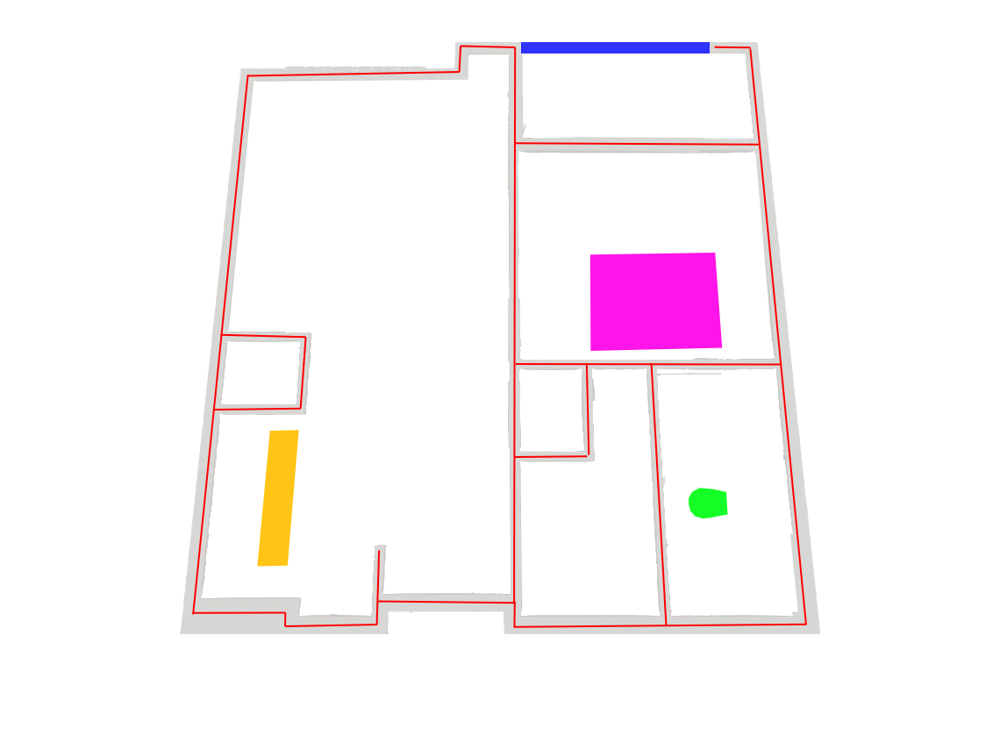

# 3D to 2D Architectural CAD Floor Plan Pipeline

A computer vision and computational geometry pipeline that converts 3D perspective marketing apartment renders into measurement-ready, publication-grade 2D architectural CAD blueprints, layered SVGs, and RFC 7946 GeoJSON feature collections.

---

## Executive Summary

Marketing floor plans are almost universally distributed as stylized 3D perspective cutaway renders (`.webp`/`.png`). While visually appealing to prospective tenants, these renders are mathematically unsuitable for space planning, architectural compliance, and property management:
- Walls are vertically extruded into the $Z$-axis, occluding floor-wall boundaries.
- Perspective camera pitch causes parallel walls to converge toward vanishing points.
- Volumetric interior furniture (sofas, beds, kitchen islands) hides 30%–50% of the true floor plane.

This project delivers a robust, measurement-ready 2D CAD reconstruction engine. By strategically decoupling visual semantic interpretation from deterministic geometric synthesis, the pipeline outputs orthogonal, zero-gap, zero-overlap 2D vector plans complete with room labels, verified square footages, conformal dimension callouts, and clean architectural headers.

| Raw 3D Perspective Marketing Render | Synthesized 2D Architectural CAD Blueprint |
| :---: | :---: |
|  |  |
| *Perspective camera tilt, occluded floor seams, 3D furniture clutter* | *True 2D orthographic plan, standard walls, metric scale, zero gaps* |

---

## The Architecture (Iteration 5)

The production-grade **Iteration 5** pipeline utilizes a pragmatic **Human-in-the-Loop (HITL)** semi-automated architecture. Rapid human semantic markup isolates topological room connectivity and fixture anchors, enabling a deterministic mathematical Python engine to handle precision geometry, Manhattan alignment, scale calibration, and publication rendering.

```text
3D Marketing Render (.webp) + Semantic Guide (.png)
   │
   ├─► Phase 1: 1D Pitch Vanishing-Point Homography
   │     Removes camera tilt, restoring plumb orthogonal walls.
   │
   ├─► Phase 2: Morphological Door Bridging & Topological Cell Extraction
   │     Bridges doorway breaks and extracts closed, non-overlapping room cycles.
   │
   ├─► Phase 3: Manhattan Planar Graph Regularization
   │     • Douglas-Peucker simplification
   │     • Direction-aware 0°/90° edge snapping (cardinal clustering)
   │     • Wall thickness normalization (standard 6"–8" structural partitions)
   │     • Shapely planar polygonization enforcing 0 gaps and 0 overlap
   │
   ├─► Phase 4: Conformal Metric Scaling & Dimensioning
   │     Calculates master scale (px/ft) from filename/OCR metadata with multi-fixture
   │     cross-validation; computes bounding span dimensions and room areas.
   │
   └─► Phase 5: Architectural CAD Blueprint & Vector GIS Synthesis
         • Synthetic CAD blueprint (PNG) with top header banner and compact badges
         • Layered vector blueprint (SVG)
         • Geographic / CAD vector data (RFC 7946 GeoJSON in architectural feet)
```

### Core Processing Stages (Visual Walkthrough)

| Phase | Description | Visual Artifact |
| :---: | :--- | :---: |
| **Input** | **Lightweight Human Semantic Guide:** Red wall centerlines, pink beds, yellow countertops, green toilets, and blue balconies drawn in $<60\text{s}$ to abstract away 3D extrusions and furniture clutter. |  |
| **Phase 1** | **Homography Rectification (`rectification.py`):** Estimates camera pitch from vertical wall vanishing points and warps the render and guide onto a plumb orthographic ground plane. |  |
| **Phase 2** | **Topological Room Extraction (`topology.py`):** Axial morphological closing bridges doorway openings while wall masks prevent bleeding across rooms, extracting closed room cycles with zero overlap. |  |
| **Phase 3** | **Manhattan Regularization (`geometry.py`):** Douglas-Peucker simplification, direction-aware $0^\circ/90^\circ$ snapping, and wall thickness normalization ($\ge 10\text{ px} \approx 6\text{ in}$). Enforces $0.0000\text{ px}^2$ gaps and overlaps. |  |
| **Phase 4** | **Conformal Metric Scaling (`scale.py`):** Computes master scale $S = \sqrt{A_{\text{px}} / A_{\text{target}}}$ with multi-fixture cross-validation (beds, counters, toilets); derives length $\times$ width room spans. |  |
| **Phase 5** | **Architectural CAD Synthesis (`visualizer.py` & `export.py`):** Renders high-resolution blueprints with top header banner, compact badges, layered SVGs, and RFC 7946 GeoJSON. |  |

---

## Core Assumptions

1. **Idealized Semantic Guidance:**
   The pipeline accepts a lightweight human semantic guide (drawn in under 60 seconds per asset) denoting wall centerlines and fixture anchors. This bypasses 3D height occlusions, decorative rugs, drop shadows, and complex rendering engine noise.
2. **Manhattan-World Geometry:**
   Apartment layouts are assumed to adhere predominantly to Manhattan-world principles—structural walls and partitions meet at orthogonal $0^\circ$ and $90^\circ$ angles.
3. **Conformal Metadata / OCR Scaling:**
   True real-world square footage is established from unit marketing metadata (e.g., `593 Sq. Ft.`, `625sq`) or OCR dimension callouts. Scale is distributed uniformly across the planar vector graph, with local multi-fixture verification.

---

## Quickstart & Usage

The pipeline is fully containerized with Docker and Docker Compose. No local Python environment configuration or system-level GIS libraries are required.

### 1. Build and Run via Docker Compose

Execute the end-to-end pipeline across all marketing assets:

```bash
# Build the Docker container (if not already cached)
docker compose build

# Run the complete Iteration 5 CAD synthesis pipeline
docker compose run --rm cv-floorplan python -u scripts/v5_test_blueprint.py
```

### 2. Processing a Single Asset

To process an individual floor plan render:

```bash
docker compose run --rm cv-floorplan python -u scripts/v5_test_blueprint.py \
  --input "inout_data/heritage towers_a1_1 Bed 1 Bath 593 Sq. Ft..webp"
```

### 3. Running Individual Pipeline Stages

Each stage can be verified and evaluated independently:

```bash
# Phase 1: 1D Pitch Vanishing Point Rectification
docker compose run --rm cv-floorplan python -u scripts/v5_test_rectification.py

# Phase 2: Topological Door Bridging & Room Cycle Extraction
docker compose run --rm cv-floorplan python -u scripts/v5_test_topology.py

# Phase 3: Manhattan Graph Regularization & Zero-Overlap Check
docker compose run --rm cv-floorplan python -u scripts/v5_test_geometry.py

# Phase 4: Conformal Scaling & Dimension Spans
docker compose run --rm cv-floorplan python -u scripts/v5_test_scale.py
```

---

## Results Summary

The Iteration 5 pipeline was verified across all three representative test assets, achieving a 100% pass rate on all Stage-Gated Quality Assurance checks:

| Asset Name | Target Area | Net Room Area | Gross Footprint | Structural Wall Area | Overlap | Gaps | Gate 5 Status |
| :--- | :---: | :---: | :---: | :---: | :---: | :---: | :---: |
| **Heritage Towers A1** | $593\text{ sq ft}$ | $593.0\text{ sq ft}$ | $744.9\text{ sq ft}$ | $151.9\text{ sq ft}$ ($20.4\%$) | **$0.0000\text{ px}^2$** | **$0.0000\text{ px}^2$** | **PASS** |
| **Highlandlux Citadel** | $623\text{ sq ft}$ | $623.0\text{ sq ft}$ | $752.9\text{ sq ft}$ | $129.9\text{ sq ft}$ ($17.3\%$) | **$0.0000\text{ px}^2$** | **$0.0000\text{ px}^2$** | **PASS** |
| **Limestone Ranch Santa Fe** | $625\text{ sq ft}$ | $625.0\text{ sq ft}$ | $781.8\text{ sq ft}$ | $156.8\text{ sq ft}$ ($20.1\%$) | **$0.0000\text{ px}^2$** | **$0.0000\text{ px}^2$** | **PASS** |

### Final Publication Blueprint Gallery

The pipeline outputs publication-ready, measurement-accurate 2D blueprints with top architectural header banners that guarantee 0% occlusion of floor plan geometries:

#### 1. Heritage Towers — A1 (1 Bed 1 Bath, 593 Sq. Ft.)


* **Gross Footprint:** $744.9\text{ sq ft}$ ($69.2\text{ m}^2$) | **Solid Walls:** $151.9\text{ sq ft}$ ($20.4\%$)
* **Net Rooms:** $593.0\text{ sq ft}$ ($541.6\text{ sq ft}$ interior conditioned $+ 51.4\text{ sq ft}$ private balcony)
* **Master Conformal Scale:** $1\text{ ft} = 23.08\text{ px}$ ($1.32\text{ cm/px}$)

#### 2. Highlandlux — Citadel (1 Bed 1 Bath, 623 Sq. Ft.)


* **Gross Footprint:** $752.9\text{ sq ft}$ ($70.0\text{ m}^2$) | **Solid Walls:** $129.9\text{ sq ft}$ ($17.3\%$)
* **Net Rooms:** $623.0\text{ sq ft}$ ($560.1\text{ sq ft}$ interior conditioned $+ 62.9\text{ sq ft}$ private balcony)
* **Master Conformal Scale:** $1\text{ ft} = 20.89\text{ px}$ ($1.46\text{ cm/px}$)
* **Unobstructed View:** Room 3 (outdoor balcony) and Room 7 are 100% visible and unblocked.

#### 3. Limestone Ranch — Santa Fe (625 Sq. Ft.)


* **Gross Footprint:** $781.8\text{ sq ft}$ ($72.6\text{ m}^2$) | **Solid Walls:** $156.8\text{ sq ft}$ ($20.1\%$)
* **Net Rooms:** $625.0\text{ sq ft}$ ($591.7\text{ sq ft}$ interior conditioned $+ 33.3\text{ sq ft}$ private balcony)
* **Master Conformal Scale:** $1\text{ ft} = 22.13\text{ px}$ ($1.38\text{ cm/px}$)

### Output Deliverables

Output artifacts are automatically exported to `data/output/`:
- **Publication Blueprints:** `blueprint_v5_<unit>.png` (synthetic CAD sheets with top header banner, metric pill cards, and room callout badges).
- **Scalable Vector Graphics:** `blueprint_v5_<unit>.svg` (layered vectors: grid, structural walls, rooms, dimension callouts, header).
- **Architectural GIS Datasets:** `blueprint_v5_<unit>.geojson` (RFC 7946 compliant GeoJSON in real-world architectural feet).
- **Intermediate Debug Visualizations:** `data/output/debug_v5/<unit>/` (step-by-step overlays for rectification, topology masks, regularized Manhattan geometry, and metric scale anchors).

---

## Deep Technical Context: The R&D Retrospective

Why did four earlier iterations of fully automated pipelines fail, and why is this semi-automated architecture the mathematically sound choice for 3D floor plan conversion?

For an in-depth failure analysis covering **the 3D extrusion problem**, **the homography trap**, **furniture contour hugging**, **zero-shot object classification collapse**, and our **long-term path to automated production**, read the complete engineering retrospective:

👉 **[ENGINEERING.md](ENGINEERING.md)**
